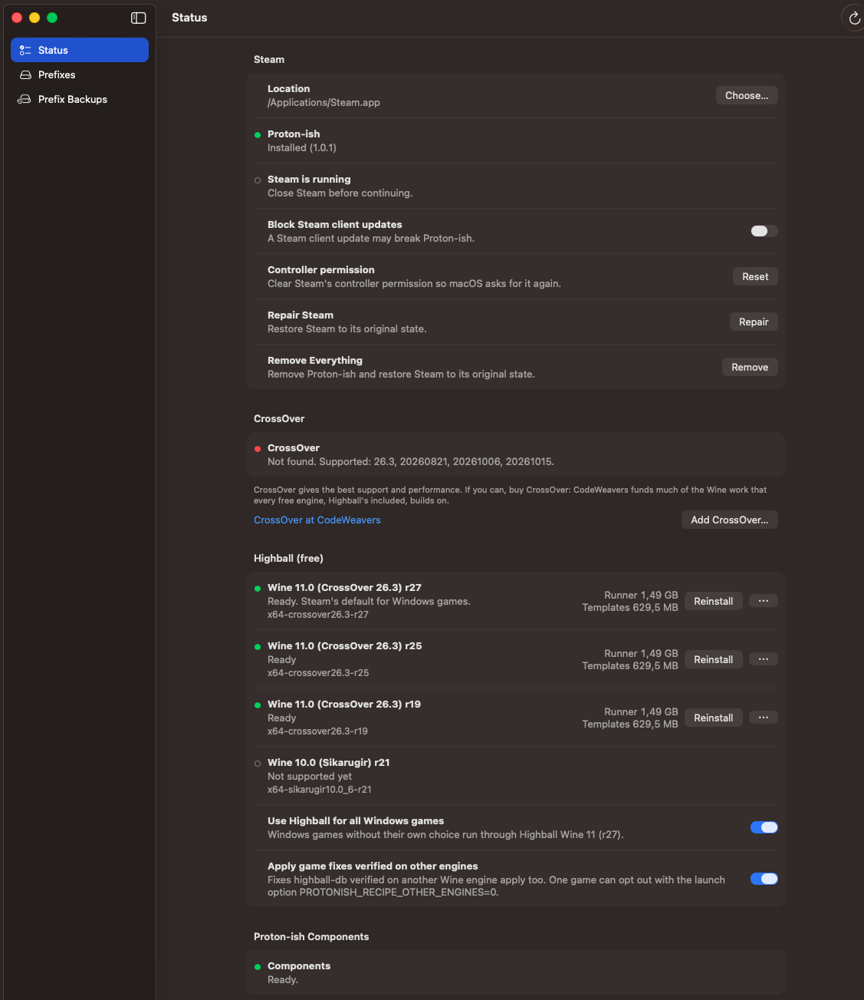

# Proton-ish

Play Windows games from your normal macOS Steam library. Proton-ish adds Steam Play to the Mac version of Steam, the
way Proton does on Linux: pick a Windows game, press Play, and it runs through Wine, with
[Highball](https://github.com/gauthierpiarrette/highball)'s free engine or with [CrossOver](https://www.codeweavers.com/crossover).

## What you get

- **Your Steam library as it is.** Windows games sit next to your Mac games and start with Steam's own Play button.
  No second launcher, no second library.
- **Steam keeps doing its job.** Steam Cloud saves, sign-in, the overlay and Steam Input go through Steam as usual.
- **Free to play.** Proton-ish downloads Highball's free Wine 11 engine for you and runs each game with Highball's own
  launch settings and per-game fixes from [highball-db](https://github.com/gauthierpiarrette/highball-db), which
  arrive with every update.
- **CrossOver as well.** Own CrossOver? Proton-ish sets it up as a Steam compatibility tool too, and you choose per game.
- **Updates itself** through **Proton-ish → Check for Updates…** or `brew upgrade`.

## Set up

You need an Apple Silicon Mac with macOS 15 or newer and [Steam for macOS](https://store.steampowered.com/about/).

1. **Install** with `brew install --cask magnuspladsen/tap/proton-ish`, or download `Proton-ish.zip` from
   [Releases](https://github.com/MagnusPladsen/Proton-ish/releases) and move `Proton-ish.app` to Applications.
2. **Open it.** It is not notarized, so macOS blocks the first launch: go to **System Settings → Privacy & Security**
   and click **Open Anyway**.
3. **Click Install** on the Status screen, and allow **App Management** when macOS asks: Proton-ish adds Steam Play to
   the Steam app.
4. **Click Download…** next to **Highball engine** (about 440 MB). First you see Apple's licence for D3DMetal, which
   DirectX 12 games use: accept it, or download without it. Already have the Highball app, or CrossOver? Click
   **Set Up** next to it instead.
5. **Restart Steam and press Play.** macOS offers to install Rosetta 2 the first time it is needed.

A game that also has a Mac version runs the Mac version. To play the Windows one, open the game's
**Properties → Compatibility**, tick **Force the use of a specific Steam Play compatibility tool** and pick
**Highball Wine 11 (r27)**.

## Support Wine development

Highball's engine and CrossOver both run on [Wine](https://www.winehq.org/), and most Wine development is done by
[CodeWeavers](https://www.codeweavers.com/), the company behind CrossOver. If you can, buying
[CrossOver](https://www.codeweavers.com/crossover) is the most direct way to support future Wine development, and
Proton-ish supports it fully alongside Highball's engine. The app shows this note once and keeps it under
**Help → Support Wine Development**.

## Reporting problems

Open an [issue](https://github.com/MagnusPladsen/Proton-ish/issues) with the game's `protonish-run.log` (in the game's
prefix). The Steam integration, the setup and the launch are Proton-ish's, even when Highball's engine runs the game,
so start here. If it turns out to be the engine, the issue will point you to the right place: highball-db for a game
that also misbehaves in the Highball app, or [Highball's issues](https://github.com/gauthierpiarrette/highball/issues)
for an engine bug reproduced there. Please don't report Proton-ish setups to Highball, NotProton, CodeWeavers or Valve.

## More

- [Using Proton-ish](docs/using-proton-ish.md): supported engines, graphics modes, game fixes, saves, CrossOver
  builds, limits (VAC, NTFS) and what Install changes on your Mac.
- [Developing Proton-ish](docs/development.md): building from source, the source layout, and how the fork keeps up
  with NotProton and Highball.
- [Changelog](CHANGELOG.md): every change Proton-ish makes to NotProton, by date.

## Thanks

- **[Highball](https://github.com/gauthierpiarrette/highball)** by Gauthier Piarrette, for a free, open-source
  Wine runtime for Apple Silicon. Proton-ish runs games with Highball's engine, its launch code (HighballKit, GPLv3)
  and its per-game database ([highball-db](https://github.com/gauthierpiarrette/highball-db), CC0).
- **[NotProton](https://github.com/NotProtonNot/NotProton)** by NotProtonNot, for the Steam integration,
  the macOS lsteamclient port and steam-shim. Proton-ish is a fork of NotProton; all of that work is theirs.
- **[CodeWeavers](https://www.codeweavers.com/)**, for maintaining and funding [Wine](https://www.winehq.org/)
  for decades and publishing CrossOver's sources.
- **[Valve](https://github.com/ValveSoftware/Proton)**, for Proton, lsteamclient and steam_helper.
- NotProton's README thanks earlier projects with similar goals, noting that NotProton was not built on their work,
  and Proton-ish passes those thanks on: [Kaon](https://github.com/natbro/kaon) by [Nat Brown](https://github.com/natbro),
  [Neutron](https://github.com/mont127/Neutron) by mont127, and [Gio](https://github.com/giodotblue), who worked on
  enabling Steam Play in macOS Steam before NotProton was released. The original NotProton README is at
  https://github.com/NotProtonNot/NotProton#readme.

> Proton-ish is a fork of NotProton and is **not affiliated with or endorsed by** NotProton, Valve,
> CodeWeavers or Highball.

## Contributing and license

Issues and pull requests are welcome; see [CONTRIBUTING.md](CONTRIBUTING.md). Licensing is described in
[NOTICE](NOTICE).
