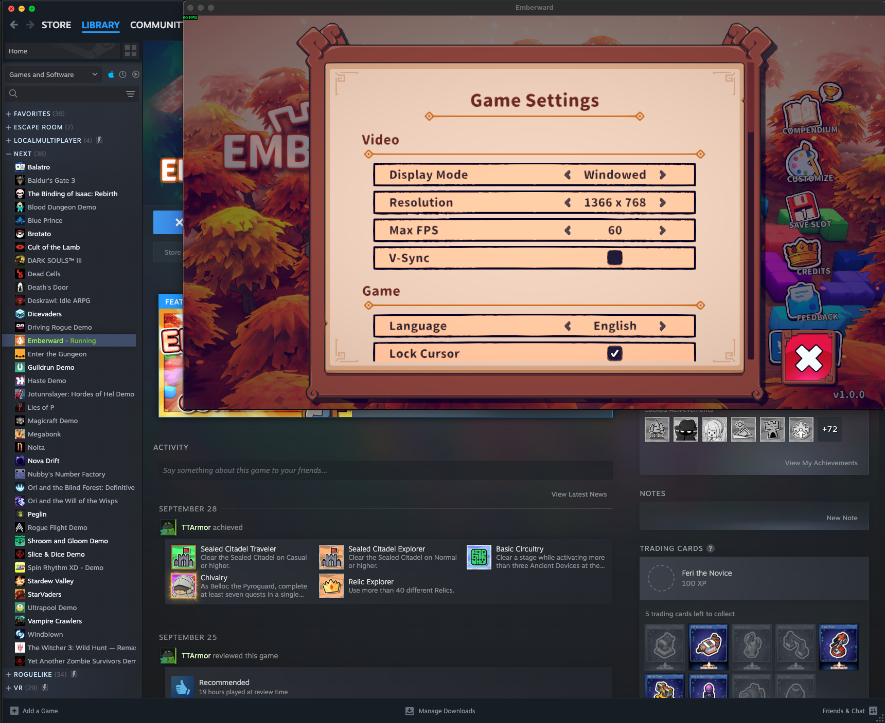
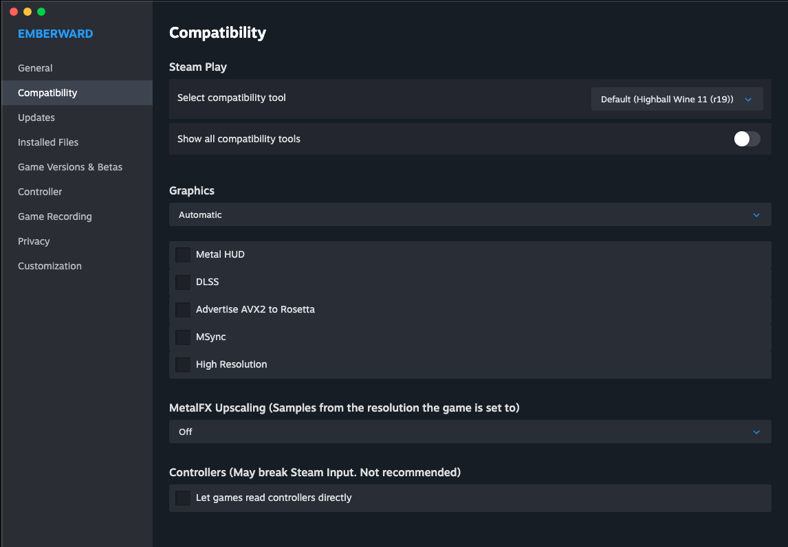

# Proton-ish

Proton-ish brings the Steam Play experience from Linux Steam to the macOS Steam client.
Pick a Windows game in your normal macOS Steam library, choose a compatibility tool, press Play.

## Why Proton-ish exists

[NotProton](https://github.com/NotProtonNot/NotProton) made Steam Play work on macOS, but it only
supports [CrossOver](https://www.codeweavers.com/crossover), which is a paid product. Today there are
good free and open-source Wine runtimes for the Mac, such as [Highball](https://github.com/gauthierpiarrette/highball).
Proton-ish adds support for those, starting with Highball's Wine 11 engine, so nobody has to pay just to
play the Windows games they already own. CrossOver stays fully supported.

If you can afford it, please consider buying CrossOver anyway: CodeWeavers funds most of the Wine
development that every free runtime, Highball included, is built on.

## Thanks

- **[CodeWeavers](https://www.codeweavers.com/)**, for maintaining and funding [Wine](https://www.winehq.org/)
  for decades and publishing CrossOver's sources. Without them there would be no Wine on macOS.
- **[NotProton](https://github.com/NotProtonNot/NotProton)** by NotProtonNot, for the Steam integration,
  the macOS lsteamclient port and steam-shim. Proton-ish is a fork of NotProton; all of that work is theirs.
- **[Highball](https://github.com/gauthierpiarrette/highball)** by Gauthier Piarrette, for a free, open-source
  Wine runtime for Apple Silicon that makes a CrossOver-free setup possible.
- **[Valve](https://github.com/ValveSoftware/Proton)**, for Proton, lsteamclient and steam_helper.

> Proton-ish is a fork of NotProton and is **not affiliated with or endorsed by** NotProton, Valve,
> CodeWeavers or Highball. Please report Proton-ish problems at
> https://github.com/MagnusPladsen/Proton-ish/issues, never to those projects.

## Status

Proton-ish is in early development and has **no releases yet**. Highball support works: a Windows game
(Emberward) launched from the macOS Steam client through Highball's free Wine 11 engine (`x64-crossover26.3-r19`)
on an Apple Silicon Mac, with Steam sign-in and the overlay working. That is one game on one Mac so far; expect
rough edges. Until the first release, build it from source (below) or use
[upstream NotProton](https://github.com/NotProtonNot/NotProton) with CrossOver.





## Using Highball

1. Install [Highball](https://github.com/gauthierpiarrette/highball). In Highball, open an environment's settings and
   set **Advanced → Engine** to `x64-crossover26.3-r19` (Wine 11). Wine 10 engines are not supported yet.
2. Open Proton-ish and allow it under **System Settings → Privacy & Security → App Management** (it modifies the
   Steam app). Click **Install** on the Status screen, then **Set Up** next to the engine in the Highball section.
3. Restart Steam. In a Windows game's **Properties → Compatibility**, choose **Highball Wine 11 (r19)** and press Play.

Only Windows games go through a compatibility tool. Games with a native macOS version run as normal macOS apps;
to run the Windows version of such a game instead, force a compatibility tool in its Compatibility settings.
Design and roadmap: [design spec](docs/superpowers/specs/2026-10-14-protonish-highball-design.md).

## Changes from upstream

- 2026-10-14: Rebranded to Proton-ish (bundle ID `com.magnuspladsen.protonish`, support
  directory `~/Library/Application Support/protonish/`, tool names `protonish-*`, own update feed).
- 2026-10-14: New app icon (two crossed orbits around a wine drop), replacing upstream's artwork.
- 2026-10-14: Internal groundwork for more Wine runtimes: runners now live in
  `runners/<runtime>-<build>/root/`, and compatibility tools record their runtime. No change for CrossOver users.
- 2026-10-14: Highball support: set up Highball's Wine 11 engine (`x64-crossover26.3-r19`) as a Steam Play compatibility tool.
- 2026-10-14: Steam is signed with a local certificate so it keeps its macOS permissions across updates; Wine's server directory is fixed when another tool left it open.
- 2026-10-14: First pre-release, 0.1.0-beta.1.

## Installing a test build

Pre-releases are on the [Releases page](https://github.com/MagnusPladsen/Proton-ish/releases).

1. Download `Proton-ish.zip`, unzip it and move `Proton-ish.app` to Applications.
2. The app is not notarized (that needs a paid Apple developer account), so macOS blocks the first launch.
   Open it once, then allow it under **System Settings → Privacy & Security → Open Anyway**.
3. Grant **App Management** when asked (Proton-ish modifies the Steam app), then click **Install**.
4. The first install creates a "Proton-ish Local Signing" certificate in your login keychain and signs Steam
   with it, so Steam keeps its Accessibility permission across Proton-ish updates. macOS may ask once whether
   `codesign` may use it: choose **Always Allow**.
5. Follow "Using Highball" above. Updates arrive through **Proton-ish → Check for Updates…**.

Please report problems at https://github.com/MagnusPladsen/Proton-ish/issues with the game's `protonish-run.log`.

## Building from source

- Xcode 27 (the same toolchain upstream CI uses); older Xcode versions fail to type-check the app.
- `brew install shellcheck node` for the lint and panel checks.
- `make dobby && make all && make app-tests` builds the dylib and runs the Swift tests;
  `make bridge fonts app` builds the full `out/Proton-ish.app` (the bridge step compiles a Wine tree and takes a while).
- `make brandcheck` must stay clean: it fails if an upstream NotProton identifier slips back in.

The upstream NotProton documentation follows, unchanged. Its install and usage steps apply to Proton-ish
(with Proton-ish in place of NotProton). Its policy statements, such as CrossOver being the only supported
runtime, and its first-person notes are upstream's own and do not describe Proton-ish.

---

This is done by forcibly enabling the Steam Play functionality in macOS Steam (which is
present and inert) as well as by porting some components of Valve's Proton to macOS.

This tool is intended to be used with the stable Steam Client (version 1791918634) as well as the beta Steam Client (version 1791686101) paired with **CrossOver 26.3 or CrossOver [Preview](https://www.codeweavers.com/preview)
20261006 or 20260821**, with more supported versions to come.

Supporting specifically CrossOver is a design goal of this project. Better support for modifying CrossOver (using custom builds of DXMT/patched D3DMetal/MacGameVideoFix) will come in a future update, but support for alternatives to CrossOver itself is not planned.

Both the FEX and the Rosetta versions are supported. I recommend using the FEX version of the 
Preview 20261006, as it includes both the FEX version as well as the Rosetta one. 

I further recommend going into Steam Settings - Compatibility and selecting the Rosetta version as your default compatibility tool. You can select FEX on a per game basis by right clicking a game in Steam, going into Properties - Compatibility and selecting FEX there.

If a game has a native macOS version as well as a Windows one, Steam will download the macOS version. To override this behavior, right click on the game, select Properties, select Compatibility. Enable 'Force the use of a specific Steam Play compatibility tool'. Select whichever version of CrossOver you want to do use. That will make Steam download the Windows version. Unchecking the 'Force the use...' box or selecting 'No Compatibility Tool' in the drop down list will revert to the macOS version of the game, with the specifics there varying based on your Steam version.

**Valve Anti-Cheat is not supported.** Proton itself does not support VAC in Valve titles; Valve ships native Linux ports instead. VAC titles will launch in Insecure Mode and will not allow matchmaking. 

**Homebrew:** not available yet for Proton-ish.

Please read NOTICE for license information.

Please open issue reports with any issues. PRs are welcome and encouraged.

There are many people who worked on similar ideas, similar projects. I did not base NotProton on their work, but I still want to 
give thanks to the people who came before me:

[Nat Brown](https://github.com/natbro) made [Kaon](https://github.com/natbro/kaon), which is similar in goals to NotProton.

mont127's [Neutron](https://github.com/mont127/Neutron) is also a similar idea, but implemented differently. 

[Gio](https://github.com/giodotblue) was working enabling Steam Play inside of Steam on macOS prior to the release of NotProton itself. 
I would have done things differently had I been aware of that. 

Thanks to everyone who has positively contributed to macOS gaming. 

Developer Notes:

As far as the source structure goes, the macOS app itself is located in the ```app``` folder. The core logic is in ```dylib```.
```lsteamclient``` is a macOS port of Valve's lsteamclient. ```steam-shim```is a port of Valve's
steam-helper from Proton 9.0. ntdll-patch patches the copy of CrossOver that the app
makes/places in the ```~/Library/Application Support/protonish/runners/``` folder so that
lsteamclient is loaded.
